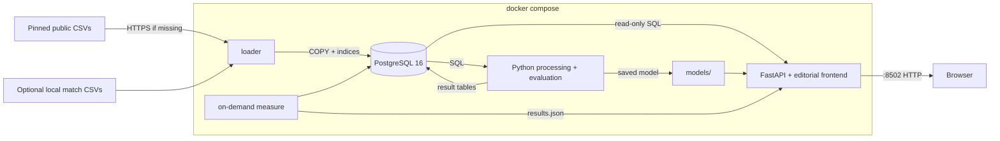

# Calcio Champagne

An editorial football data journal: what do transfer budgets buy, and does
attacking output track league results? **[Local app](http://localhost:8502)** ·
[Architecture](docs/ARCHITECTURE.md) · [Audit](docs/AUDIT.md) ·
[LUISS requirements](docs/COURSE_REQUIREMENTS.md) · [Presentation route](docs/DEFENSE.md)

## Question

Does recorded incoming transfer spending predict an improvement in next season's
Champagne Index, `(goals + assists) / source matches`? Does that index accompany
a better same-season league finish? [Measured findings and limitations](docs/findings.md).
The index is a project-specific attacking-output proxy, not xG or an official rating.

## Team

A **solo portfolio exercise** by [@Ataika](https://github.com/Ataika), practicing
the workflow from LUISS's Computational Infrastructures for Data Science course.
Four GitHub accounts are owned by the same person. This is not a four-person
course submission. The original Lecture 15 brief has been checked page by page;
[the mapping](docs/COURSE_REQUIREMENTS.md) distinguishes implementation from
requirements that need real people, source permission or independent validation.

## How to run

Install Docker Desktop, then:

```bash
git clone https://github.com/Ataika/Calcio-Champagne-prediction-automated-system
cd Calcio-Champagne-prediction-automated-system
cp .env.example .env
docker compose up --build
```

Open **http://localhost:8502**. Missing primary CSVs download automatically from a
pinned public revision, without a Kaggle account. First startup needs network and
roughly 353 MiB of source files; prepared files are reused offline. Source headers
and downloaded hashes are checked before database loading. Do not confuse a
network download or Docker image build with a measured cached-source run.

Optional enrichment: manually place completed-match CSVs at
`data/matches/{E0,SP1,I1,D1,F1}/{2122,2223,2324,2425,2526}.csv`. Missing enrichment
leaves league positions unavailable; the index, spending and Lab still work.
Then recompute with `docker compose up --build --force-recreate` (volume retained).

The app includes overview charts, league filters, club profiles, comparisons,
real-input scenarios, CSV export and a Project page with sources and measurements.
The default is a complete league season; 25/26 is a partial attacking-data snapshot.
Original Streamlit reference: `docker compose --profile legacy up -d legacy`,
then http://localhost:8503. Primary API docs: http://localhost:8502/api/docs.

## Interfaces and head-to-head comparison

| Interface | Appearance | Address |
| --- | --- | --- |
| Primary journal | Paper background, burgundy/olive accents, editorial typography | http://localhost:8502 |
| Legacy Streamlit | Dark background and gold accents; optional `legacy` Compose profile | http://localhost:8503 |

The primary interface has one visual theme. Club-style clusters described below
are analytical categories, independent of interface appearance.

Select two clubs in the directory or season table and open **Compare**. Alongside
their season totals, the comparison reports league goals for (GF), goals against
(GA), goal difference (GD = GF − GA), and per-match attacking and defensive
ranks. These score-derived ranks are within the selected league-season; equal
rates share a rank. **Head to head** is a separate view of their completed
meetings in the selected league and season: dates and home/away scores,
wins/draws/losses, goals scored and conceded, goal difference, goals per match,
clean sheets and points.
For example, [Inter vs. Milan, Serie A 24/25](http://localhost:8502/?league=IT1&season=24%2F25&teams=46,5#compare)
contains the two recorded league matches, 1–2 and 1–1. The totals are Inter 2–3
Milan, with one draw and one Milan win. Their season comparison is Inter 79/35/+44
(attack rank 1, defense rank 2) and Milan 61/43/+18 (ranks 3 and 7).

These are league-only meetings in the selected season, not the clubs' entire
rivalry or cup results. Match scores come from the optional football-data.co.uk
enrichment; missing coverage is shown explicitly. Match-level assists are absent
from that source, so the comparison does not invent them or derive a head-to-head
Champagne Index from season-level assists.
The optional player source also provides goalkeeper conceded totals. Those agree
with the match-source GA in 366/388 adequately covered top-five club-seasons;
clean-sheet totals agree in only 269/388 and are not used as a league ranking.
No xG field exists in the loaded match schema.

## Defense preparation materials

The offline study site, English report, Russian team guide, four personal study
cards, 15-minute slide deck and downloadable archives are in `defense/`. Open
`defense/site/index.html` in a browser for the interactive study pages; open
`defense/site/presentation.html` for keyboard-driven slides and speaker notes.
Browser checkmarks stay in local storage. Rebuild the HTML, PDFs and archives
with a local Chrome installation using:

```bash
python3 scripts/build_defense.py
node scripts/render_defense.mjs
python3 scripts/package_defense.py
```

The report records what remains unverified, including the primary source licence
and independent second-machine validation. Role cards guide preparation; they
do not prove authorship or substitute for each person's actual contribution.

## Analysis and club styles

The main model predicts the change in Champagne Index for the next consecutive
season from five inputs: current index, total transfer spend, attacking spend,
squad average age and change in average player market value. Evaluation holds
out later seasons together and compares against predicting zero change. The Lab
uses a separately fitted all-data model for retrospective scenarios. See the
[model protocol and measured evaluation](docs/LAB.md).

An optional K-Means analysis assigns eligible club-seasons to **four groups**:

| Group | How the name is assigned |
| --- | --- |
| Lower-tier / data-sparse | The centroid with the lowest combined recorded discipline and conceded-goal rates; missing coverage can drive this group |
| Shoestring overachievers | Lowest mean transfer spend among the other three centroids |
| Mid-table grinders | Middle mean transfer spend among the other three centroids |
| Big-spending elite | Highest mean transfer spend among the other three centroids |

Clustering uses attacking output, spend efficiency, discipline, goals conceded
per match and clean-sheet rate, with reserve/youth squads excluded and at least
15 source matches. Names are derived from each run's centroids; they are
exploratory statistical labels, not validated tactical styles or league ranks.
Several clubs can share a group. Visual themes are a separate interface choice.

The optional analysis is not part of the default startup. After the database and
main pipeline have completed, generate or refresh its results with:

```bash
docker compose run --rm --no-deps pipeline python club_style_clustering.py
```

Club profiles display a saved group when available for that club, season and
competition. Refresh these results after changing the dataset or core pipeline.

## Verification

No test dependencies need to be installed on the host:

```bash
docker compose run --rm --no-deps -v "$PWD:/source:ro" -w /source app \
  python -m unittest discover -s tests -v
python3 scripts/check_live.py
# Optional: local Chrome and Node 22+, isolated browser profile.
node scripts/browser_check.mjs
```

Live and browser checks accept a primary-data setup without optional match CSVs.
They verify head-to-head totals when meetings exist and an explicit coverage
message otherwise. Acquisition tests use fake HTTP responses and exercise
interrupted downloads, checksum/header failures, normalization and offline reuse.
`/api/health` returns 503 for missing output tables or empty results and reports
saved-model availability separately.

## Data

[Public source and pinned revision](https://github.com/salimt/football-datasets/tree/da9227e1f42baf74561324290dbf1ad2e3c00edd):
11 Transfermarkt CSV tables. The existing local snapshot has 5,743,186 rows;
ten files match upstream exactly. One legacy club-competition metadata table
has a different schema/row count; fresh acquisition explicitly normalizes the
pinned upstream version. This table does not feed the core index or models.
See [source provenance, hashes and acquisition](docs/SOURCES.md).

**Unresolved licence requirement:** the pinned source has no explicit licence
file. Public downloadability does not establish an open licence. The earlier
Kaggle link and unsupported “open licence” claim have been removed. Confirm the
licence upstream or choose a clearly licensed replacement before claiming this
part of LUISS compliance. Raw data is excluded from Git.

Optional [football-data.co.uk](https://www.football-data.co.uk/data.php) enrichment:
8,908 locally prepared matches, five leagues, 21/22–25/26. Download by hand;
no scraper is added. Club names are resolved using `sql/team_name_map.sql`.

## Architecture



PostgreSQL fits fixed-column tables joined by player, club, competition and season.
Compose waits for database health and successful loader/pipeline completion. The
pipeline computes canonical club-season rows, valid next-season targets, five
model inputs and comparable standings. The app reads bounded output tables;
sliders call a saved model rather than retrain it. [Model protocol](docs/LAB.md).
Cloud, Spark, Kubernetes, ML and a custom website are optional in Lecture 15;
the database, Compose and measured system remain the course core.

## Measurements

Run separately, with no concurrent training, browser tests or other benchmarks:

```bash
# Three repetitions of query/index and 25/50/100% growth experiments.
docker compose run --rm measure
# Three complete starts; reimports sources and retrains; preserves files/volume.
python3 scripts/measure_system.py
# Synchronize the measured README table and detailed report.
python3 scripts/report_measurements.py
```

Each command saves executed results, not estimates, in ignored
`measure/results/results.json`; individual repetitions, conditions, timestamps,
processor/RAM and observed per-container memory remain inspectable. The original
single-run benchmark is superseded by the following executed protocol.

<!-- MEASUREMENTS:START -->
Laptop: **Apple M3 Pro**, 18 GiB RAM, 12 logical CPUs. Docker VM: 12 CPUs, 7.70 GiB memory. Three repetitions; arithmetic means below. Query benchmark: 2026-11-04T18:48:23.854996+00:00; final system pipeline completed: 2026-11-04T18:46:23.540122+00:00.

| Measurement | Result |
| --- | ---: |
| Complete cached-source startup → API ready | 31.10 s |
| Loader: source checks, COPY, indices, enrichment | 12.53 s |
| Pipeline: aggregation, fitting, saved outputs | 9.70 s |
| 300 club lookups, without index | 10.872 s |
| 300 identical club lookups, with index | 0.075 s (145.4× faster) |
| Database footprint, including indices | 695.5 MiB |
| Original local CSVs, including enrichment | 356.6 MiB |
| db: highest observed working-set RAM | 250.6 MiB |
| loader: highest observed working-set RAM | 17.9 MiB |
| pipeline: highest observed working-set RAM | 500.9 MiB |
| app: highest observed working-set RAM | 107.3 MiB |

| Largest-table share | Rows | Load mean | Query mean |
| --- | ---: | ---: | ---: |
| 25% | 469,679 | 1.40 s | 0.297 s |
| 50% | 939,359 | 2.94 s | 0.552 s |
| 100% | 1,878,719 | 6.18 s | 0.998 s |

Sources were already downloaded; images were already built. Each full run recreates containers, reimports source rows and retrains the model, retaining the database volume. OS/database caches are not flushed. Other host/Docker workloads were not controlled. Memory is the maximum sampled `docker stats` working set across the three runs, not a guaranteed instantaneous peak. Query and full-system protocols ran separately. This snapshot uses the preserved legacy metadata table.
<!-- MEASUREMENTS:END -->

Interpretation and measurement limits: [detailed report](docs/MEASUREMENTS.md).

## Who did what

Three personas organize the work into the following groups. All accounts belong
to one author; the groups describe practiced responsibilities, not separate people.

| Work group | Account | Git email | Responsibilities |
| --- | --- | --- | --- |
| Data, SQL and measurements | nedalozanovska | `neda.lozanovska@gmail.com` | Pinned CSV acquisition, header/hash validation, loader, canonical SQL aggregation, repeated infrastructure measurements and source provenance |
| Analysis, prediction and evaluation | lilllaz | `lilllaz@users.noreply.github.com` | Consecutive-season targets, competition-safe feature lags, chronological RandomForest evaluation, saved Lab model, optional defensive-spend analysis, head-to-head API and analytical interpretation |
| Interface and integration | jacoposcaccianoce | `jacoposcaccianoce@users.noreply.github.com` | FastAPI, editorial frontend, season and head-to-head comparison, attack/defense ranks, Compose integration, API/browser checks and handoff documentation |

Ataika owns the repository and authored the initial schema, loader, pipeline,
Compose setup and enrichment. Those historical bootstrap/integration commits are
separate from the three-persona allocation. The persona identities above are
verified against the existing Git history; new attribution must use the account
that actually authored and committed the work.

### Balanced commit series

The original November audit and head-to-head update, ending at `b8d0d0a`, contains
**six commits after baseline `6f34edb`: two per work group**.

| Account | Implementation commit | Follow-up commit | Count |
| --- | --- | --- | ---: |
| nedalozanovska | Validated source imports, canonical SQL and infrastructure measurements | Work-group responsibilities and Git identities in README | 2 |
| lilllaz | Correct consecutive targets, feature lags and chronological model evaluation | Head-to-head API/statistics, regression/live checks and analytical documentation | 2 |
| jacoposcaccianoce | Editorial dashboard, HTTP API, runnable setup and validation | Head-to-head interface, browser checks, API handoff and README publication details | 2 |

Verify the allocation from the branch checkout:

```bash
git shortlog -sne 6f34edb..b8d0d0a
```

### Smaller follow-up tasks

The next six changes are independently reviewable tasks, two per work group:

| Account | Task 1 | Task 2 | New commits |
| --- | --- | --- | ---: |
| nedalozanovska | Validate completed match dates, scores and season filenames | Clear stale optional results and reject conflicting duplicate fixtures | 2 |
| lilllaz | Verify safe downloads, checksums, normalization and offline reuse | Make live/browser verification work with optional match enrichment | 2 |
| jacoposcaccianoce | Check all required output tables and nonempty results for readiness | Document acceptance checks, small work packages and remaining submission steps | 2 |

[Acceptance checks and the remaining submission steps](docs/WORK_PACKAGES.md)
describe what each task delivers. The combined update after `6f34edb` has
**12 commits, four per persona** through `158e8d8`; earlier project history is
preserved. The later data comparison and exam-preparation package add two
commits authored and committed by `lilllaz`; these are not attributed to the
other accounts.

```bash
git shortlog -sne b8d0d0a..158e8d8  # six smaller follow-up commits
git shortlog -sne 6f34edb..158e8d8  # twelve commits across the two series
git shortlog -sne 158e8d8..HEAD     # two later commits by the active account
```

GitHub authentication controls permission to push. The author/committer emails
above determine commit attribution, independently of the browser sign-in account.

November audit and editorial frontend were implemented with Codex assistance on
`codex/calcio-editorial-audit`. [Audit record](docs/AUDIT.md) documents source and
model corrections and actual checks. Git history was not rewritten to invent
contributors, elapsed weeks or presentation evidence.
