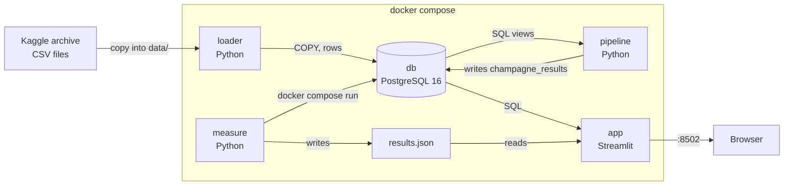

# Calcio Champagne

Does a football team's spending on attacking-position transfers predict a rise in its
**Champagne Index** — attacking output per match — the following season?

## Team

| Name | GitHub |
|---|---|
| Ataika | [@Ataika](https://github.com/Ataika) |
| jacoposcaccianoce | [@jacoposcaccianoce](https://github.com/jacoposcaccianoce) |
| lilllaz | [@lilllaz](https://github.com/lilllaz) |

## How to run

1. Install [Docker Desktop](https://www.docker.com/products/docker-desktop/).
2. `git clone https://github.com/Ataika/Calcio-Champagne-prediction-automated-system`
3. Download the dataset (see **Data** below) and copy its 11 folders into `data/`, so you
   end up with e.g. `data/player_performances/player_performances.csv`.
4. `cp .env.example .env`
5. `docker compose up`
6. Open <http://localhost:8502>

Optional, once the stack is up: `docker compose run --rm measure` runs the performance
benchmark and writes `measure/results/results.json`, which the dashboard's
**Performance** tab reads — reload the page after it finishes.

## Data

[Transfermarkt football data](https://www.kaggle.com/datasets/davidcariboo/player-scores)
(Kaggle, open licence). 11 CSV tables, ~353 MB, ~5.7M rows total: player profiles,
season-by-season performances per team/competition, transfer history, market-value
history, injuries, national-team performances, teammate history, and team/competition
metadata. No match-by-match results exist in this dataset — only player-season
aggregates — which is why the Champagne Index (below) is built the way it is.

## Architecture



**Boxes** are the containers. **Arrows** show data moving: CSV rows into Postgres, SQL
query results back out, a shared `results.json` file between the benchmark and the
dashboard. `loader` → `pipeline` → `app` run in that order automatically
(`service_completed_successfully` in `docker-compose.yml`); `measure` is a separate
on-demand tool, not started by `docker compose up`.

## Database: PostgreSQL, and why

All 11 CSVs are flat tables with fixed columns and clear foreign keys (`player_id`,
`team_id`, `competition_id`, `season_name` tie every table together) — a relational
model with joins and indices is the natural fit. See `sql/schema.sql`.

## Processing

**Champagne Index**, per `team_id, season_name, competition_id`:

```
champagne_index = (SUM(goals) + SUM(assists)) / MAX(nb_in_group)
```

`nb_in_group` is constant across all of a team's players in the same
team/season/competition row group in this dataset — the closest proxy available to
"number of matches that season" without match-level data. See
`sql/champagne_queries.sql`.

**Transfer spend**, per `team_id, season_name`: sum of incoming `transfer_fee`, split
into total spend and spend specifically on `main_position = 'Attack'` players.

**Prediction**: `pipeline/compute_predictions.py` fits one global linear trend
(`scipy.stats.linregress`) of *next season's change in Champagne Index* against *this
season's transfer spend*, across every team-season with at least 5 matches played.
That trend line is what "predicted next-season index" in the dashboard comes from — a
simple regression, not a trained ML model.

## What the dashboard shows

- **Ranking** — Champagne Index leaderboard, filterable by competition and season.
- **Team trend** — one team's index over time, with its predicted next-season value.
- **Spend vs. output** — the scatter plot and fitted trend line the prediction is
  based on, with the correlation (r) and p-value.
- **Performance** — the measurements below, read live from `measure/results.json`.

## Measurements

Laptop: Docker Desktop, machine reported as `Linux-6.12.76-linuxkit-aarch64` (the Linux
VM Docker Desktop runs containers in). Produced by `measure/benchmark.py`.

**Query time, with vs. without an index** — looking up one team's Champagne Index
across 300 different teams (`player_performances` filtered by `team_id`, which is what
the "Team trend" tab does):

| | without index | with index |
|---|---:|---:|
| 300 team lookups | 11.07 s | 0.07 s |

The index on `(team_id, season_name, competition_id)` makes this **~158× faster**.

**Database size on disk**: 665.9 MB (Postgres + indices, vs. 353 MB of raw CSVs).

**Peak memory per container** (`docker stats`, see README step above):

| container | peak memory |
|---|---:|
| db | 284.7 MB |
| loader | 14.5 MB |
| pipeline | 256.5 MB |
| app | 40.1 MB |

**Growth test**: load time and query time on `player_performances` (the largest table,
150 MB / 1.9M rows) at 25%, 50% and 100% of its rows:

| data | rows | load time | query time |
|---|---:|---:|---:|
| 25% | 469,679 | 1.38 s | 0.38 s |
| 50% | 939,359 | 2.88 s | 0.61 s |
| 100% | 1,878,719 | 5.99 s | 1.04 s |

Load time roughly doubles when the data doubles (COPY is linear in row count); query
time grows more slowly, since most of it is fixed per-query overhead.

**What the numbers mean**: the model found only a very weak correlation between a
team's transfer spend and next season's change in Champagne Index (see the "Spend vs.
output" tab for the exact r and p-value from the last pipeline run) — across the whole
dataset, spending alone doesn't predict a more attacking team next season.

## Who did what

| | |
|---|---|
| Ataika | data, loader, schema, Docker Compose, measurements, README |
| jacoposcaccianoce | database queries, processing pipeline |
| lilllaz | dashboard, architecture diagram |

(To be updated with the real commit history once everyone has pushed.)
