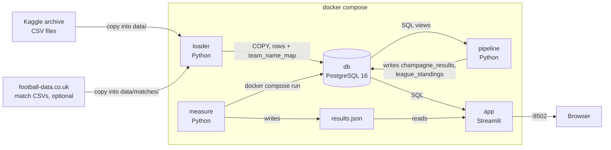

# Calcio Champagne

Does a football team's spending on attacking-position transfers predict a rise in its
**Champagne Index** — attacking output per match — the following season? And does a
high Champagne Index actually mean a team finishes higher in the table?

## About this project

A personal/portfolio project, built solo across four of my own GitHub accounts as
deliberate practice for the team-project workflow taught in LUISS's *Computational
Infrastructures for Data Science* course — same shape (team of 4, public dataset,
Docker Compose, measured performance) and same git discipline (branches, pull
requests, review before merge). My actual course team built a different project —
this one isn't submitted as LUISS coursework.

| Account | Role played |
|---|---|
| [@Ataika](https://github.com/Ataika) | Infra: schema, loader, pipeline, Docker Compose, measurements |
| [@jacoposcaccianoce](https://github.com/jacoposcaccianoce) | README validation, non-technical track |
| [@nedalozanovska](https://github.com/nedalozanovska) | SQL exploration, non-technical track |
| [@lilllaz](https://github.com/lilllaz) | Prediction model, technical track |

## How to run

1. Install [Docker Desktop](https://www.docker.com/products/docker-desktop/).
2. `git clone https://github.com/Ataika/Calcio-Champagne-prediction-automated-system`
3. Download the dataset (see **Data** below — you'll need a free Kaggle account to
   download it) and copy its 11 folders into `data/`, so you end up with exactly these
   11 paths:
   ```
   data/player_profiles/player_profiles.csv
   data/player_performances/player_performances.csv
   data/player_market_value/player_market_value.csv
   data/player_latest_market_value/player_latest_market_value.csv
   data/player_injuries/player_injuries.csv
   data/player_national_performances/player_national_performances.csv
   data/player_teammates_played_with/player_teammates_played_with.csv
   data/team_details/team_details.csv
   data/team_competitions_seasons/team_competitions_seasons.csv
   data/team_children/team_children.csv
   data/transfer_history/transfer_history.csv
   ```
   If the Kaggle zip extracts flat (all CSVs in one folder, no subfolders), you'll need
   to make these 11 subfolders yourself and move each CSV into its matching one — the
   loader reads each file at its own path, not just anywhere under `data/`.
4. (Optional but recommended) Download the match-results enrichment — see **Data**
   below — into `data/matches/{E0,SP1,I1,D1,F1}/{season}.csv`, where `{season}` is the
   4-digit code football-data.co.uk itself uses (e.g. `2425.csv` for the 24/25 season),
   not `24-25` or `2024-25`.
5. `cp .env.example .env`
6. `docker compose up`
7. Open <http://localhost:8502>

Optional, once the stack is up: `docker compose run --rm measure` runs the performance
benchmark and writes `measure/results/results.json`, which the dashboard's
**Performance** tab reads — reload the page after it finishes.

**Starting over**: if you want to reload after fixing your `data/` layout (or just want
a clean slate), `docker compose down -v` first — `up` alone won't re-run the loader
once the database volume already exists.

## Data

**Main dataset**: [Transfermarkt football data](https://www.kaggle.com/datasets/davidcariboo/player-scores)
(Kaggle, open licence). 11 CSV tables, ~353 MB, ~5.7M rows total: player profiles,
season-by-season performances per team/competition, transfer history, market-value
history, injuries, national-team performances, teammate history, and team/competition
metadata. No match-by-match results exist in this dataset — only player-season
aggregates — which is why the Champagne Index (below) is built the way it is.

**Enrichment (optional)**: [football-data.co.uk](https://www.football-data.co.uk/data.php)
match results (open, free, download by hand — their terms disallow automated
bots/scrapers). 25 CSVs, top-5 leagues (`E0` Premier League, `SP1` LaLiga, `I1` Serie
A, `D1` Bundesliga, `F1` Ligue 1) × 5 seasons (21/22–25/26), ~8,900 matches, ~4 MB.
Gives the project something the main dataset doesn't have: a real league table
(points, goal difference, final position) to check the Champagne Index against. Club
names differ between the two sources (e.g. "Man United" vs. "Manchester United") — see
`sql/team_name_map.sql` for the hand-verified 130-club mapping across all 5 leagues.

## Architecture



**Boxes** are the containers. **Arrows** show data moving: CSV rows into Postgres, SQL
query results back out, a shared `results.json` file between the benchmark and the
dashboard. `loader` → `pipeline` → `app` run in that order automatically
(`service_completed_successfully` in `docker-compose.yml`); `measure` is a separate
on-demand tool, not started by `docker compose up`.

## Database: PostgreSQL, and why

All 11 CSVs are flat tables with fixed columns and clear foreign keys (`player_id`,
`team_id`, `competition_id`, `season_name` tie every table together) — a relational
model with joins and indices is the natural fit. See `sql/schema.sql`.

## Processing

**Champagne Index**, per `team_id, season_name, competition_id`:

```
champagne_index = (SUM(goals) + SUM(assists)) / MAX(nb_in_group)
```

`nb_in_group` is constant across all of a team's players in the same
team/season/competition row group in this dataset — the closest proxy available to
"number of matches that season" without match-level data. See
`sql/champagne_queries.sql`.

**Transfer spend**, per `team_id, season_name`: sum of incoming `transfer_fee`, split
into total spend and spend specifically on `main_position = 'Attack'` players.

**Prediction**: `pipeline/compute_predictions.py` fits one global linear trend
(`scipy.stats.linregress`) of *next season's change in Champagne Index* against *this
season's transfer spend*, across every team-season with at least 5 matches played and
excluding reserve/youth squads (identified via `team_children`, not mixed in with
their first team). That trend line is what "predicted next-season index" in the
dashboard comes from — a simple regression, not a trained ML model.

**Richer model (Issue #3)**: the same pipeline also fits a `RandomForestRegressor`
predicting next-season Δ Champagne Index from five features — current
`champagne_index`, `total_spend`, `attacking_spend`, squad average age
(`player_profiles.date_of_birth`), and the change in the squad's average market value
vs. the previous season (`player_market_value`) — written to `champagne_model_ml`.
Excluding reserve/youth squads barely moves the linear fit (r goes from -0.014 to
-0.018, still no real signal — spend alone just isn't predictive). The richer model
does meaningfully better: test R² = 0.125 vs. the linear baseline's ~0, with
`champagne_index` itself as by far the strongest feature (69% importance, i.e. the
biggest predictor of next season's index is mostly how good this season already was),
followed by `total_spend` (15%) and `squad_avg_age` (10%).

**League standings** (optional, needs the football-data.co.uk enrichment):
`compute_standings()` builds a real league table — points, goal difference, final
position — from `match_results`, joins it to `champagne_results` by team+season, and
fits a second linear model checking whether Champagne Index actually predicts league
position. Written to `league_standings` and `champagne_vs_position_model`.

## What the dashboard shows

- **Ranking** — Champagne Index leaderboard, filterable by competition and season.
- **Team trend** — one team's index over time, with its predicted next-season value.
- **Spend vs. output** — the scatter plot and fitted trend line the spend-prediction
  is based on, with the correlation (r) and p-value.
- **Standings** — real league table per league/season, plus the Champagne Index vs.
  league position scatter and correlation (only populated if the match enrichment
  was loaded).
- **Performance** — the measurements below, read live from `measure/results.json`.

## Measurements

Laptop: Docker Desktop, machine reported as `Linux-6.12.76-linuxkit-aarch64` (the Linux
VM Docker Desktop runs containers in). Produced by `measure/benchmark.py`.

**Query time, with vs. without an index** — looking up one team's Champagne Index
across 300 different teams (`player_performances` filtered by `team_id`, which is what
the "Team trend" tab does):

| | without index | with index |
|---|---:|---:|
| 300 team lookups | 11.71 s | 0.08 s |

The index on `(team_id, season_name, competition_id)` makes this **~153× faster**.

**Database size on disk**: 641.5 MB (Postgres + indices, vs. 353 MB of raw CSVs + ~4
MB of match enrichment).

**Peak memory per container** (`docker stats`, see README step above):

| container | peak memory |
|---|---:|
| db | 201.7 MB |
| loader | 15.8 MB |
| pipeline | 254.5 MB |
| app | 38.9 MB |

**Growth test**: load time and query time on `player_performances` (the largest table,
150 MB / 1.9M rows) at 25%, 50% and 100% of its rows:

| data | rows | load time | query time |
|---|---:|---:|---:|
| 25% | 469,679 | 1.41 s | 0.38 s |
| 50% | 939,359 | 3.00 s | 0.67 s |
| 100% | 1,878,719 | 6.04 s | 1.08 s |

Load time roughly doubles when the data doubles (COPY is linear in row count); query
time grows more slowly, since most of it is fixed per-query overhead.

**What the numbers mean**:

- **Champagne Index vs. real league position** (top-5 leagues, 2021–2026, 484
  team-seasons): **r = -0.663, p < 0.0001**. A higher Champagne Index goes with a
  better (lower-numbered) finish — the metric actually tracks real results, not just
  a disconnected stat. This is the headline finding: it validates that "goals +
  assists per match" is a meaningful proxy for how good a team's season was, even
  though the main dataset has no match results of its own.
- **Transfer spend vs. next season's Δ Champagne Index** (whole dataset, all
  competitions, 1960–2025): r ≈ -0.014, not significant, and restricting to
  first-team squads only (excluding reserve/youth teams via `team_children`, see
  Issue #3) barely moves it to r ≈ -0.018 — still no signal. Spending alone does not
  predict a more attacking team next season, with or without the reserve/youth
  teams mixed in. A richer model (RandomForest, five features) does find real
  signal though: test R² = 0.125 — see **Richer model** above.

## Commit log by account

See the **About this project** section above — all four accounts are mine, used to
practice the branch → PR → review → merge workflow solo.

| | |
|---|---|
| Ataika | data, loader, schema, Docker Compose, measurements, README, match enrichment |
| jacoposcaccianoce | README validation (Issue #1) |
| nedalozanovska | SQL exploration (Issue #2) |
| lilllaz | prediction model (Issue #3) |
