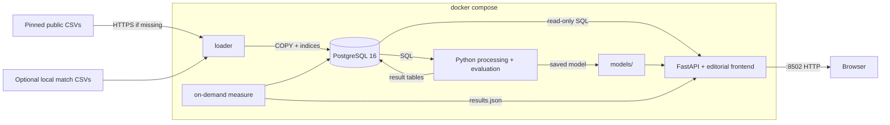

# Calcio Champagne

An editorial football data journal: what do transfer budgets buy, and does
attacking output track league results? **[Local app](http://localhost:8502)** ·
[Architecture](docs/ARCHITECTURE.md) · [Audit](docs/AUDIT.md) ·
[LUISS requirements](docs/COURSE_REQUIREMENTS.md) · [Presentation route](docs/DEFENSE.md) ·
[Licence decision](docs/LICENCE_DECISION.md) · [Fresh checkout](docs/FRESH_CHECKOUT.md)

## Research Question

Does recorded incoming transfer spending predict an improvement in next season's
Champagne Index, `(goals + assists) / source matches`? Does that index accompany
a better same-season league finish? See [measured findings and limitations](docs/findings.md).
The index is a project-specific attacking-output proxy, not xG or an official rating.

## Team & Contributions

Built collaboratively as a four-person data engineering and analytics project for
the MSc in Data Science and Management at LUISS Guido Carli:

| Member | GitHub | Role & Core Responsibilities |
| --- | --- | --- |
| **Atai Keneshbekov** | [@Ataika](https://github.com/Ataika) | **System Architecture, Docker & Infrastructure:** Docker Compose orchestration, service healthchecks, container networking, reproducibility setup, and end-to-end system benchmarking. |
| **Neda Lozanovska** | *Neda Lozanovska* | **Data Engineering & SQL Pipeline:** Pinned CSV acquisition, header/checksum validation, PostgreSQL 16 schema design, `COPY` data loader, canonical SQL aggregations, and index optimization. |
| **Lilia** | [@lilllaz](https://github.com/lilllaz) | **ML Modeling, Statistical Analysis & API:** Consecutive-season target engineering, competition-safe feature lags, chronological `RandomForest` evaluation, interactive Lab model, K-Means club clustering, and analytical interpretation. |
| **Jacopo Scaccianoce** | [@jacoposcaccianoce](https://github.com/jacoposcaccianoce) | **Frontend, Product Integration & QA:** FastAPI endpoints, editorial web application, club profile and head-to-head comparison UI, attack/defense league rankings, browser/live verification checks, and presentation documentation. |

## Quickstart

Install Docker Desktop, then run:

```bash
git clone https://github.com/Ataika/Calcio-Champagne-prediction-automated-system
cd Calcio-Champagne-prediction-automated-system
cp .env.example .env
docker compose up --build
```

Open **http://localhost:8502** (API documentation at **http://localhost:8502/api/docs**).

* **Automatic data setup:** Missing primary CSVs download automatically from a pinned public revision (no Kaggle account required). First startup requires internet access for ~353 MiB of source files; subsequent runs reuse local files offline after verifying headers and SHA hashes.
* **Optional match enrichment:** Place completed-match CSVs in `data/matches/{E0,SP1,I1,D1,F1}/{2122,2223,2324,2425,2526}.csv` and run `docker compose up --build --force-recreate` (retaining the DB volume). Without enrichment, league standings are omitted while the Champagne Index, transfer spend views, and Lab remain fully functional.
* **Legacy Streamlit reference:** Run `docker compose --profile legacy up -d legacy` and open **http://localhost:8503**.

## Interfaces & Head-to-Head Comparison

| Interface | Appearance | Address |
| --- | --- | --- |
| Primary journal | Paper background, burgundy/olive accents, editorial typography | http://localhost:8502 |
| Legacy Streamlit | Dark background and gold accents; optional `legacy` Compose profile | http://localhost:8503 |

Select any two clubs in the directory or season table and open **Compare** to view:
* **Season Totals:** League goals for (GF), goals against (GA), goal difference (GD = GF − GA), and per-match attacking/defensive ranks within the selected league-season.
* **Head-to-Head:** Completed league meetings in the selected season with dates, home/away scores, W/D/L record, goal difference, goals per match, clean sheets, and points (e.g., [Inter vs. Milan, Serie A 24/25](http://localhost:8502/?league=IT1&season=24%2F25&teams=46,5#compare)).

### Methodological Notes on Match Data
* Comparisons cover league meetings within the selected season only (excluding domestic cups and European competitions).
* Match-level assists are unavailable in the enrichment source, so head-to-head views do not extrapolate a match-level Champagne Index from season-level assists.
* Goalkeeper conceded totals from the player dataset align with match-source GA in 366/388 well-covered top-five club-seasons; clean-sheet counts agree in 269/388 and are therefore excluded from league rankings.
* Observed match metrics (shots, shots on target, corners, cards) cover 8,907 of 8,908 completed matches. Shots-on-target conversion estimates and descriptive Poisson attack/defense fits are explicitly labeled as proxies rather than provider xG. See [source usage policy](https://www.football-data.co.uk/contact.php) and [full source notes](docs/SOURCES.md).

## Analysis & Club Style Clustering

The main predictive model estimates next-season change in the Champagne Index from five features: current index, total transfer spend, attacking spend, squad average age, and change in average player market value. Evaluation uses chronological season holdouts benchmarked against a zero-change baseline. The interactive **Lab** uses a separately fitted full-dataset model for retrospective what-if scenarios. See [model protocol and measured evaluation](docs/LAB.md).

An optional K-Means clustering step segments eligible club-seasons (excluding reserve/youth teams and seasons with `<15` source matches) into four exploratory profiles based on attacking output, spend efficiency, discipline, goals conceded per match, and clean-sheet rate:

| Cluster | Assignment Rule |
| --- | --- |
| Lower-tier / data-sparse | Centroid with the lowest combined recorded discipline and conceded-goal rates |
| Shoestring overachievers | Lowest mean transfer spend among the remaining three centroids |
| Mid-table grinders | Middle mean transfer spend among the remaining three centroids |
| Big-spending elite | Highest mean transfer spend among the remaining three centroids |

Generate or refresh cluster assignments after the main pipeline completes:

```bash
docker compose run --rm --no-deps pipeline python club_style_clustering.py
```

## Architecture



Compose orchestrates container health and execution order: `loader` validates and bulk-loads relational tables into PostgreSQL 16, `pipeline` computes canonical club-season metrics and trains/serializes the predictive model, and `app` serves bounded SQL queries and pre-trained inference via FastAPI.

## Data Sources

* **Primary dataset:** [Pinned Transfermarkt snapshot](https://github.com/salimt/football-datasets/tree/da9227e1f42baf74561324290dbf1ad2e3c00edd) (11 CSV tables, 5,743,186 rows). Acquisition normalizes schema differences and verifies file hashes prior to loading. See [provenance and acquisition details](docs/SOURCES.md).
  * *Licence note:* The upstream repository lacks an explicit open-source licence file; raw CSVs are excluded from Git and fetched at runtime.
* **Enrichment dataset:** [football-data.co.uk](https://www.football-data.co.uk/data.php) (8,908 completed matches across the top five European leagues, 21/22–25/26, manually downloaded for academic coursework and mapped via `sql/team_name_map.sql`).

## Verification & Defense Materials

Run the test suite and live checks inside Docker without installing host dependencies:

```bash
docker compose run --rm --no-deps -v "$PWD:/source:ro" -w /source app \
  python -m unittest discover -s tests -v
python3 scripts/check_live.py
# Optional end-to-end browser check (requires local Chrome and Node 22+)
node scripts/browser_check.mjs
```

Presentation materials—including the 23-page report, interactive offline study guide (`defense/site/index.html`), and 15-minute slide deck (`defense/site/presentation.html`)—live in `defense/` and can be rebuilt via:

```bash
python3 scripts/build_defense.py
node scripts/render_defense.mjs
python3 scripts/package_defense.py
```

## Measurements

Run benchmarks independently without concurrent workloads:

```bash
docker compose run --rm measure        # 3x query/index & 25/50/100% scaling runs
python3 scripts/measure_system.py      # 3x cold-container full pipeline runs
python3 scripts/report_measurements.py # Sync results.json into README & docs
```

<!-- MEASUREMENTS:START -->
Laptop: **Apple M3 Pro**, 18 GiB RAM, 12 logical CPUs. Docker VM: 12 CPUs, 7.70 GiB memory. Three repetitions; arithmetic means below. Query benchmark: 2026-11-04T18:48:23.854996+00:00; final system pipeline completed: 2026-11-04T18:46:23.540122+00:00.

| Measurement | Result |
| --- | ---: |
| Complete cached-source startup → API ready | 31.10 s |
| Loader: source checks, COPY, indices, enrichment | 12.53 s |
| Pipeline: aggregation, fitting, saved outputs | 9.70 s |
| 300 club lookups, without index | 10.872 s |
| 300 identical club lookups, with index | 0.075 s (145.4× faster) |
| Database footprint, including indices | 695.5 MiB |
| Original local CSVs, including enrichment | 356.6 MiB |
| db: highest observed working-set RAM | 250.6 MiB |
| loader: highest observed working-set RAM | 17.9 MiB |
| pipeline: highest observed working-set RAM | 500.9 MiB |
| app: highest observed working-set RAM | 107.3 MiB |

| Largest-table share | Rows | Load mean | Query mean |
| --- | ---: | ---: | ---: |
| 25% | 469,679 | 1.40 s | 0.297 s |
| 50% | 939,359 | 2.94 s | 0.552 s |
| 100% | 1,878,719 | 6.18 s | 0.998 s |

Sources were already downloaded; images were already built. Each full run recreates containers, reimports source rows and retrains the model, retaining the database volume. OS/database caches are not flushed. Memory is the maximum sampled `docker stats` working set across the three runs, not a guaranteed instantaneous peak. Query and full-system protocols ran separately. This snapshot uses the preserved legacy metadata table.
<!-- MEASUREMENTS:END -->

See [detailed measurement report](docs/MEASUREMENTS.md) for methodology and hardware limits.
