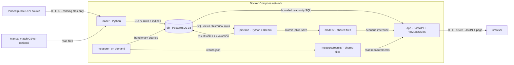

# Architecture



Service containers are loader, db, pipeline, app, and the optional measure tool.
File nodes represent shared bind mounts, not additional containers.

## Startup and persistence

`docker compose up` orders db health → successful loader → successful pipeline →
app. The loader downloads missing files from a pinned public source, checks their
hashes and ordered headers, then COPY-loads PostgreSQL. Existing sources work
without a network. Database data lives in a named volume; source files, model and
measurement artifacts stay in ignored host directories. No database port is
published to the host. The app process runs as a non-root user.

## Responsibilities

- `loader/get_data.py` and `loader/sources.json`: reproducible GET stage. See
  `SOURCES.md` for the metadata normalization and unresolved upstream licence.
- `loader/load_data.py`: STORE stage, explicit raw schema, COPY and post-load
  indices; optional match enrichment. Records per-table loading time.
- `sql/champagne_queries.sql`: canonical club-ID/season/competition aggregation.
  Display-name aliases cannot create multiple rows for the same identity.
- `pipeline/compute_predictions.py`: PROCESS stage. Valid consecutive targets,
  five-feature table, chronological evaluation, all-data Lab model and comparable
  league standings. Raw CSVs and models are not shipped in Docker build context.
- `app/api.py`: bounded, validated HTTP reads of pipeline outputs and saved-model
  inference. PostgreSQL connections default to read-only with query timeouts.
  Missing numeric data becomes JSON null, not NaN; SQL filter values are bound.
- `app/static/`: SHOW stage. Buildless ES modules, local CSS, native SVG charts.
  No Node build, CDN, external font or frontend framework is needed at runtime.
- `measure/benchmark.py`: three repetitions of index/query and growth tests;
  individual timings and means saved to JSON. Restores the index after errors.
- `scripts/measure_system.py`: host-side three-run timing and streaming
  `docker stats` observations for db, loader, pipeline and app; host/VM hardware.
- `app/dashboard.py`: original Streamlit reference, available through the optional
  `legacy` Compose profile. The editorial app is the primary product.

The API's pool avoids sharing one failed psycopg connection across concurrent
requests. Model files are replaced atomically; inference reloads a model when its
mtime changes. Persistent metrics and deployed all-data inference are distinct.

## Extend and verify

Add new derived analysis in a separate `pipeline/` script when it has independent
inputs, then expose its small output table. Never page raw player-performance
rows into a frontend. Optional exploratory analyses remain independent of startup:

```bash
docker compose run --rm --no-deps pipeline python club_style_clustering.py
docker compose run --rm --no-deps pipeline python transfer_fee_model.py
```

The transfer-fee side analysis is retrospective and uses a random split; it is
not promoted as a validated future-transfer forecast. Cluster names derive from
actual centroids; source coverage may dominate defensive features.

See `FRONTEND_HANDOFF.md` for endpoints, `LAB.md` for modeling decisions,
`COURSE_REQUIREMENTS.md` for page-level course requirements and `AUDIT.md` for
observed defects and executed verification.
